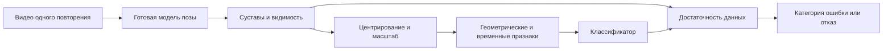

# Первоначальный план от 04.11.2026 — архив

Актуальное решение: [план от 05.11](project-plan.md). Этот документ сохранён как история первого EC3D-эксперимента.

## Цель и результат за неделю

**Конечная цель:** система оценки техники приседаний по видео с одной обычной камеры. Вход — заранее вырезанное одно повторение, один человек целиком в кадре. Выход — категория ошибки либо «недостаточно данных для оценки». Несколько повторений и другие упражнения добавляем после подтверждения качества первой версии.

**Контрольная дата: 11.11.2026.** Пользователь подтвердил RTX 2060 6 ГБ / Colab и отсутствие доступа к основным ранее обсуждавшимся наборам. На неделю выбираем готовую модель позы и небольшой классификатор. Результаты: обученная модель на доступных данных, проверка на других людях, демонстрация обработки видео и короткий отчёт. Публикационная готовность за неделю не обещается.

Сегодня выполнена классификация подготовленных скелетов. Для полной демонстрации нужны видео и проверка перехода между скелетами. Если до конца второго дня подходящие RGB-видео не получены, результат недели ограничиваем проверенным классификатором скелетов и опытом по устойчивости. Видеоинтерфейс в этом случае показываем как отдельный, пока не валидированный компонент.

## Постановка

Первое упражнение — приседание без штанги из EC3D. Основная задача — одна из пяти категорий, описанных в статье: корректное выполнение, широкая постановка ног, колени внутрь, недостаточная глубина, наклон корпуса вперёд. Дополнительная задача — «корректно / есть ошибка».

Это метки заданных лабораторных инструкций, а не универсальные нормативы всех вариантов приседания. «Корректно» относится только к проверенным критериям. Разметка EC3D не позволяет обещать обнаружение нескольких одновременных ошибок: пока задача многоклассовая, а не многометочная.

В коде сохранены исходные ID `1–5`. ID `1` означает корректное выполнение по коду авторов. Соответствие ID `2–5` названиям нужно окончательно сверить визуально до выдачи текстовых замечаний. Порядок таблицы статьи и геометрия согласуются с последовательностью «широкие ноги / колени внутрь / малая глубина / наклон», но это пока наша интерпретация.

## Выбор данных

| Набор | Роль | Основание |
|---|---|---|
| **EC3D** | Основной на неделю | Файл уже скачан и проверен; есть позы, участники и метки инструкций. Можно обучаться на CPU. |
| **Fitness-AQA** | Следующий этап: реальные видео с отягощениями | Подходит для внешней проверки после получения доступа и согласования меток. Сейчас файлов нет. |
| **FLEX/MyoMechanix** | Возможное расширение с несколькими камерами | Доступ по заявке; ожидание не входит в обязательный путь недели. |
| **UI-PRMD** | Резерв для бинарной оценки | Открытые корректные/некорректные движения, но нет отдельных нужных меток ошибок приседа. |
| **FitAQA / QEVD / REHAB26-ViewAngles** | Обзор и дальнейшие эксперименты | FitAQA распространяет задания без видео; QEVD существенно шире задачи; файлы близкого по ракурсам REHAB26-ViewAngles пока не проверены. |

Аудит EC3D: 29 789 кадров, 371 последовательность всех упражнений; 141 приседание. Берём **132 повтора: 41 с ID 1, 23 с ID 2, 23 с ID 3, 21 с ID 4, 24 с ID 5**. Ещё 9 имеют ID `10` и относятся к одному человеку. Эта метка не описана в таблице 1 статьи; исключена до уточнения. См. [аудит](../reports/ec3d_baseline/README.md).

В публичной папке авторов найдены `data_3D.pickle` (21 448 352 байта) и `data.pickle` (961 198 097 байт). По описанию авторов второй содержит в том числе параметры камер и 2D-позы; он пока не скачан. Отдельные RGB-файлы в просмотренном списке не обнаружены. Наличие исходного видео пока не подтверждено.

Отдельная лицензия EC3D не найдена в просмотренных README/дереве репозитория. Сохраняем источник, сырые данные не добавляем в Git, условия распространения уточняем до публикации. Лицензия статьи не переносится автоматически на данные.

## Пайплайн

1. Начать с MediaPipe Pose Landmarker; отдельно сохранять 2D, оценённую 3D-позу и visibility. Visibility — выход модели позы, а не вероятность правильности техники. [Документация Google](https://developers.google.com/edge/mediapipe/solutions/vision/pose_landmarker/python).
2. Сопоставить OpenPose BODY_25 в EC3D и 33 точки MediaPipe по анатомическим названиям. Общие точки: плечи, бёдра, колени, голеностопы; дополнительно сохранять маску доступности, время и ID записи.
3. Проверить совместимость признаков. 2D-углы нельзя подавать в обученный классификатор 3D-углов. MediaPipe world coordinates также не равны подготовленной позе EC3D. Сначала проверить общие 3D-признаки на размеченных видео; при плохом переносе обучать отдельно на совместимых данных. Для 2D потребуется отдельное обучение.
4. Центрировать относительно таза, масштабировать длиной корпуса. Сравнить геометрические признаки + логистическую регрессию с последовательностью координат + той же регрессией. Эти baseline уже выполнены; это не воспроизведение GCN авторов.
5. Для опыта выделить область наибольшего сгибания коленей внутри вырезанного повторения. Это оценка фазы, а не эталонная разметка. Сопоставить с использованием всего повторения.
6. Добавить отказ по достаточности точек и уверенности. Для «корректно» нужны наблюдения для всех проверяемых критериев. Невидимые суставы не превращаются в отрицательную метку ошибки.

**Реализовано:** загрузка, аудит, нормализация, признаки, классификаторы, разбиения, исходный отказ по уверенности. **Далее:** видео, соответствие систем суставов, фазы, отказ с учётом доступности.

## Научный вопрос и гипотеза

**Когда система должна отказаться от замечания, если важных суставов не видно в информативной части приседания?**

Рабочее название: **«Оценка ошибок приседаний по неполным скелетным последовательностям с контролем отказа от решения»**.

Классификация ошибок, нормализация скелета, фазы и отказ от ответа уже известны. Возможный вклад — воспроизводимый протокол проверки, помогает ли доступность суставов именно в значимой фазе уменьшить ложные замечания на новом человеке относительно обычного порога уверенности. Пока это гипотеза; отличие от ближайших работ ещё нужно доказать. См. [разбор источников](research-review-2026-11-04.md).

**H1 — практический критерий для решения о продолжении:** при покрытии около 80% учёт доступности суставов в нижней фазе снижает ложные замечания минимум на 5 процентных пунктов относительно отказа только по уверенности. Доля обнаруженных ошибок среди всех ошибочных выполнений при этом падает не более чем на 5 пунктов. Эти пороги выбраны заранее; это не ожидаемые результаты и не критерии статистической значимости.

В скачанном EC3D нет настоящих масок видимости. Первая проверка — контролируемое удаление точек/отрезков и добавление шума. Искусственные пропуски и поворот готового 3D-скелета не доказывают устойчивость к реальным перекрытиям или ракурсам. Для этого позже нужна отдельная проверка на RGB-видео.

## Протокол проверки

- Единица оценки — целое повторение. Его кадры и преобразованные копии остаются в одной части данных.
- Четыре разбиения по людям: один — тест, следующий по фиксированному алфавитному порядку — validation, два остальных — train. Каждый тестируется ровно один раз. У авторов описано обучение 3 → 1; наши цифры напрямую с ними не сравниваем.
- Масштабирование признаков учится только на train; `C=1` фиксирован. Порог отказа выбирается на validation, на test сообщаем фактическое покрытие, которое может отличаться от 80%.
- Распознавание: Macro-F1 пяти ID, F1 по классам, матрица ошибок. Ложные замечания: ошибочно выданные замечания / все корректные выполнения.
- Отказы: покрытие, ошибка среди оценённых, ложные замечания среди оценённых корректных выполнений, обнаруженные ошибки / все ошибочные выполнения, включая отклонённые. Отказ не считается успешным распознаванием.
- Сравнивать способы отказа при одинаковом покрытии по кривым «ошибка–покрытие»; для рабочего порога показать фактическое покрытие по людям и классам. Нельзя улучшить цифру, просто исключив трудные примеры.
- Искажения: без изменений; шум 1%/3% длины корпуса; пропуски коленей/голеностопов на 10%/30% длительности в начале, внизу и случайном месте. Маски и seed `0, 1, 2` одинаковы для методов; восстановление пропусков одинаково и не обращается к скрытым точкам.
- Сравнения: без отказа → по уверенности → по общей полноте → по полноте в информативной фазе. Отдельно проверить вклад выделения фазы.

Четырёх людей мало для сильных статистических выводов. Три seed и сотни искажённых копий не добавляют независимых участников. Текущий эксперимент исследовательский: все четыре человека уже анализировались. Для итоговой статьи нужна независимая внешняя проверка.

## Критерий завершения

Минимальный результат: данные и код воспроизводятся, модель обучается, ошибки измеряются по людям, границы видеоинтерфейса показаны. Целевой результат недели: проверенная обработка видео и сравнение способов отказа. Если H1 не подтверждается, сохраняем отрицательный результат и не добавляем блок ради заявленной новизны.

После недели: внешний датасет → согласование меток → настоящие пропуски/ракурсы → решение о статье. Обучаемая 3D-нормализация, sEMG, LLM-советы и много упражнений в эту неделю не входят.
