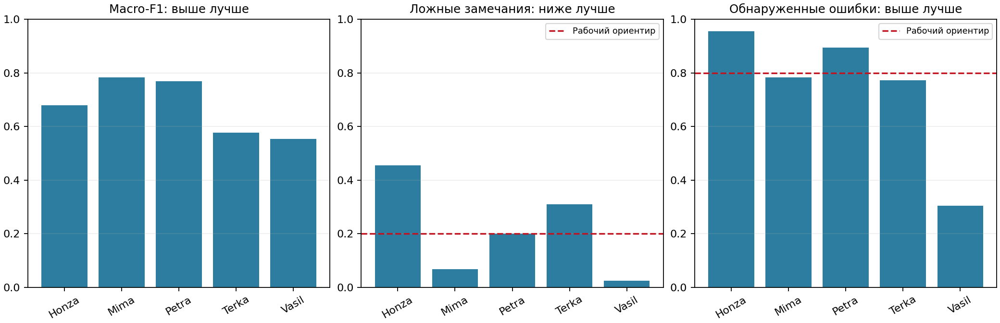
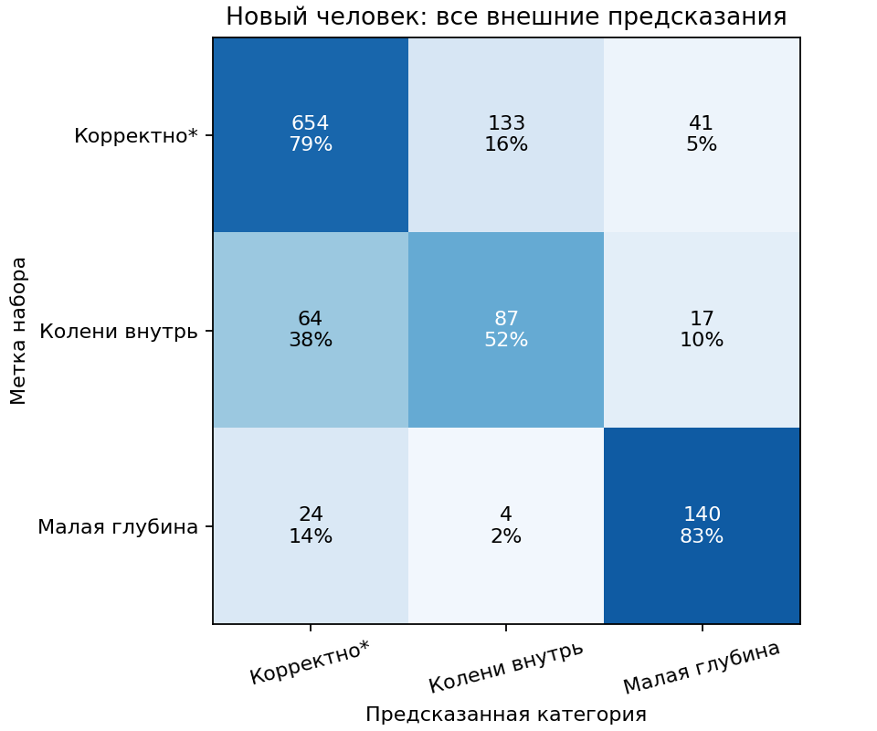

# REHAB26: первое сравнение моделей — 05.11.2026

## Результат простыми словами

Полностью подготовлены 388 физических приседаний пяти людей: 276 корректных по протоколу набора, 56 со сведением коленей и 56 недостаточно глубоких. Для каждого доступны все три камеры — 1 164 наблюдения. Три камеры не считаются тремя независимыми людьми или повторениями.

Основной автоматический результат: **Macro-F1 0.672 ± 0.095 по пяти новым людям**. В среднем модель ошибочно критикует 21.1% корректных выполнений и замечает 74.2% ошибочных. Тип ошибки определён верно в 67.9% ошибочных случаев. Ориентиры FPR≤20% и обнаружение ошибок≥80% не достигнуты; это исследовательская модель, её пригодность для автоматической обратной связи не подтверждена.

## Что действительно выполнено

- Скачаны только 15 файлов 3D-поз приседаний: 116 527 874 сжатых байта вместо всего архива; размеры/CRC32 и локальные SHA-256 проверены. Полный MD5 всего ZIP не проверялся, потому что остальные упражнения не скачивались.
- Проверены метки, анатомические индексы, границы массивов, конечность координат/visibility, связанные суставы и состав камер. Низкая visibility не отфильтрована. Нулевые placeholders в полных записях существуют, но не входят в выбранные 1 164 отрезка.
- Получены 35 геометрических признаков целого повторения. Они не используют visibility, порядок фаз или темп. Все признаки рассчитались без исключения выбранных наблюдений.
- Просмотрены галереи пяти людей: по два повторения каждой категории с двух камер; всего 60 наблюдений, по три кадра каждого. Визуализация подтверждает читаемую анатомию и движение; это просмотр скелетов, а не исходных RGB-кадров и не повторная экспертная разметка.
- Обучены исходные методы и проведён ограниченный внутренний подбор по людям. Модели сохранены вместе с предобработкой, схемой признаков и происхождением данных; ответы после загрузки сверены.

## Сопоставимое сравнение

| Метод | Macro-F1, среднее ± std по людям | Ложные замечания | Обнаруженные ошибки |
|---|---:|---:|---:|
| Постоянный ответ | 0.277 ± 0.001 | 0.0% | 0.0% |
| Регрессия, исходные настройки | 0.662 ± 0.125 | 28.8% | 78.8% |
| Регрессия с подбором | 0.672 ± 0.095 | 21.1% | 74.2% |
| SVM с подбором | 0.446 ± 0.183 | 39.3% | 59.8% |
| Ансамбль деревьев с подбором | 0.499 ± 0.089 | 20.5% | 55.3% |
| Автоматический выбор по внутренней проверке | 0.672 ± 0.095 | 21.1% | 74.2% |

Главная строка — автоматическая процедура выбора семейства и параметров **только по внутренним разбиениям**. В этом опыте она выбрала регрессию во всех пяти внешних разбиениях. Показ отдельных семейств не означает, что финальная модель выбрана по лучшему внешнему результату. Настроек всего 18: по 6 для регрессии, SVM и ExtraTrees. Ансамбль использует seed 0; дополнительные seed, аугментации и нейросеть пока не проверялись.



| Тестовый человек | Macro-F1 | Ложные замечания | Обнаруженные ошибки |
|---|---:|---:|---:|
| Honza | 0.679 | 45.5% | 95.5% |
| Mima | 0.782 | 6.7% | 78.3% |
| Petra | 0.770 | 20.0% | 89.4% |
| Terka | 0.577 | 30.9% | 77.3% |
| Vasil | 0.554 | 2.4% | 30.4% |

Разброс существенный. У Honza модель критикует 45,5% корректных выполнений, а у Vasil обнаруживает только 30,4% ошибочных. Поэтому среднее не означает одинаковой пригодности для всех людей.



По объединённым наблюдениям F1 класса «колени внутрь» — 0.444, класса «недостаточная глубина» — 0.765. Основная слабость — распознавание сведения коленей и перенос между стилями выполнения. Это основание для следующего запланированного опыта с фазовыми/относительными признаками; не доказательство, что новая архитектура обязательно поможет.

## Как проверяли

Пять внешних разбиений: один человек полностью исключён из обучения. На остальных четверых — четыре внутренних разбиения по людям для выбора настроек. После выбора обучение на четырёх, затем проверка на пятом. Scaler, балансировка и выбор параметров не используют внешнего человека. Все камеры одного движения остаются вместе.

Метрики одной камеры учитываются с весом 1/3, чтобы физическое повторение имело общий вес 1; это оценка одиночного наблюдения, не голосование камер. Таблица выше сначала усредняет классы внутри человека, затем людей. Общий Macro-F1 по объединённым предсказаниям равен 0.681 и является другим способом усреднения.

Для проверки арифметики: в объединённых наблюдениях корректных выполнений — 828, ложных замечаний — 174; наблюдений ошибочных выполнений — 336, замечаний по ним — 248, из них правильный тип ошибки — 227. Эти числа относятся к **камерам**, а не к отдельным независимым движениям. Взвешенные количества в JSON — эквиваленты физических повторений, иногда дробные.

Ориентиры проверялись при выборе внутренних вариантов; если подходящих не было, сохранялся исследовательский вариант с максимальным Macro-F1, без объявления ограничений достигнутыми. Никакой отказ в этом опыте не применялся: покрытие 100% подготовленных наблюдений. «Уверенность» не откалибрована; SVM использует оценку отступа, а не вероятность правильности.

## Ограничения и следующий шаг

- Три категории REHAB26 и пять категорий EC3D — разные задачи. Нельзя приписать улучшение модели, просто сравнив их итоговые числа.
- Только пять людей; дополнительные камеры и повторы не делают статистику независимой. Std по людям описательный; статистическая значимость улучшения не установлена.
- Все ракурсы присутствовали в обучающих людях. Это проверка нового человека при разных ракурсах, не тест неизвестного углового диапазона.
- 166 приседаний с другими ошибками остались вне основной трёхклассовой задачи. Отсутствие двух выбранных признаков не означает правильность всей техники.
- Используются уже вырезанные авторами MediaPipe world-последовательности. Raw RGB, автоматическая сегментация и другой экстрактор позы ещё не проверены; `last_frame` явно включается по принятому соглашению, точная семантика границы не подтверждена RGB-просмотром.
- Следующий опыт по ранее утверждённому плану — сравнение глобальной геометрии с относительными/фазовыми и временными признаками. Версию и правила сравнения фиксировать до запуска. Эти внешние результаты уже просмотрены: дальнейшая ручная разработка на них является исследовательской, для сильной статьи требуется независимое подтверждение.

## Запуск и файлы

```bash
python scripts/download_rehab26.py
python scripts/rehab26_baseline.py --prepare-only
python scripts/visualize_rehab26.py
python scripts/rehab26_baseline.py
python scripts/report_rehab26.py
python -m unittest discover -s tests -v
```

Суммарный измеренный запуск подготовки/подбора/оценки/финального обучения: 23.6 с на текущем CPU, без скачивания и построения галерей; GPU не использовался. Это время зависит от железа.

Финальная модель для дальнейшего использования — `models/rehab26_baseline/squat_geometry.joblib`; параметры выбирались отдельной проверкой по людям на всех данных. Она обучена на всех пяти людях, собственного независимого теста этих весов нет, порог отказа не настроен. Ещё сохранены 30 моделей внешних разбиений. Каталог моделей исключён из Git, модели восстанавливаются запуском скрипта.

Применение без обучения: `python scripts/predict_rehab26.py repetition.npy`. Вход — **одно полное повторение** формата `(кадры,33,4)` MediaPipe world xyz + visibility; EC3D и RGB напрямую не подходят. Файлы joblib загружаются только из доверенного источника.

Артефакты: [метрики](metrics.json), [предсказания камер](fold_predictions.csv), [разбиения](splits.json), [внутренний подбор](inner_search.json), [финальный выбор](final_training_selection.json), [зафиксированный запуск](run_config.json), [аудит поз](data_audit.json), [схема признаков](feature_metadata.json), [галереи](pose_galleries/).
