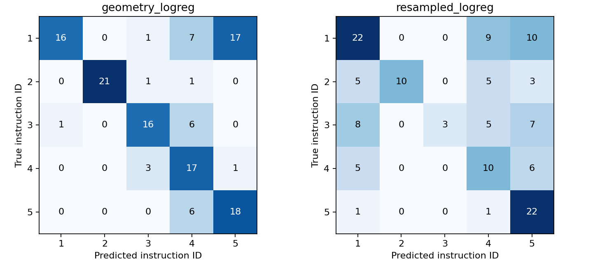

# Первый эксперимент — 04.11.2026

## Данные

Файл `data_3D.pickle` из [официального репозитория EC3D](https://github.com/Jacoo-Zhao/3D-Pose-Based-Feedback-For-Physical-Exercises), commit `1c8d28ddc8a346634f9c86335e3a261f90d6b9b2`.

SHA-256: `a05c8b4f55f2f43637d2d6cbf40722807ea780f47e84090470bd100c927ebbdf`.

- 29 789 кадров, 371 последовательность: 141 приседание, 127 выпадов, 103 планки.
- В опыт вошли 132 приседания четырёх людей с ID `1–5`; по классам: `1: 41`, `2: 23`, `3: 23`, `4: 21`, `5: 24`.
- Девять дополнительных приседаний с ID `10` принадлежат одному человеку. Метка не описана в таблице 1 статьи и исключена до уточнения. Остальные 132 примера совпадают по численности с таблицей статьи.
- Координаты конечны. Кадры объединены по упражнению, человеку, инструкции, повторению и отсортированы по номеру кадра.

Это обработанные авторами 3D-позы, а не сырые результаты однокамерной модели позы.

## Протокол

Четыре разбиения: один человек — тест, один — validation, два — обучение. Каждый человек тестируется один раз. Масштабирование признаков обучается только на train. Регрессия: `C=1`, балансировка классов; параметры не подбирались по тесту. Разбиения записаны в [splits.json](splits.json).

Геометрия: семь временных сигналов — углы коленей/бёдер и расстояния между коленями, голеностопами, тазом/опорой. По пять квантилей, всего 35 признаков. Координаты: 32 временные точки × 19 суставов × 3 координаты, всего 1 824 признака. Центрирование относительно таза, масштаб — медианная длина корпуса.

Второй baseline — линейный классификатор координат, не ST-GCN. У него намного больше признаков при том же малом числе примеров. Это сравнение не доказывает преимущества геометрии над нейросетями вообще.

## Результаты

| Метод | Бинарный Macro-F1, среднее ± std | Пять ID, Macro-F1, среднее ± std |
|---|---:|---:|
| Постоянный ответ | 0,407 ± 0,010 | 0,095 ± 0,007 |
| Геометрия + регрессия | 0,786 ± 0,233 | 0,622 ± 0,035 |
| Координаты + регрессия | 0,622 ± 0,221 | 0,432 ± 0,169 |

Среднее и std посчитаны по четырём тестовым участникам. После объединения всех тестовых предсказаний Macro-F1 геометрии — 0,828 в бинарной задаче и 0,684 по пяти ID. Эти способы усреднения не смешиваем; основной отчёт — среднее по участникам.

Проблема пятизначной геометрической модели: ложное замечание на **25 из 41 корректного повторения — 61,0%**. При этом объединённый F1 класса `2` — 0,955. Общее число скрывает разную пригодность модели для разных сообщений.

Бинарный вариант тоже нестабилен: Macro-F1 геометрии по тестовым людям примерно 0,964 / 0,965 / 0,396 / 0,820. Высокое среднее не означает устойчивости к новому человеку.

Порог отказа по уверенности выбран на validation с целевым покрытием 80%. Для пятизначной геометрической модели фактическое тестовое покрытие — 80,6%, 68,4%, 71,9%, 58,1% по людям. Это исходная диагностика; эффективность отказа с учётом суставов пока не проверялась.

## Вывод

Baseline работает и вычислительно дёшев: суммарное время обучения всех моделей во всех разбиениях на текущей машине менее секунды без учёта импорта, подготовки и графиков. Измерения каждого обучения сохранены в JSON и зависят от железа.

Следующий шаг — сверить смысл ID и совместимость с позой из видео, затем сравнить способы отказа. Проверок настоящих ракурсов, реальных перекрытий, выделения фаз и внешнего видеодатасета в этом опыте нет. Четырёх людей недостаточно для сильных выводов об обобщении.

Артефакты: [audit.json](audit.json), [manifest.csv](manifest.csv), [metrics.json](metrics.json), [predictions.csv](predictions.csv). Перезапуск: `python scripts/ec3d_baseline.py`; новый каталог — `--output reports/<название>`.
