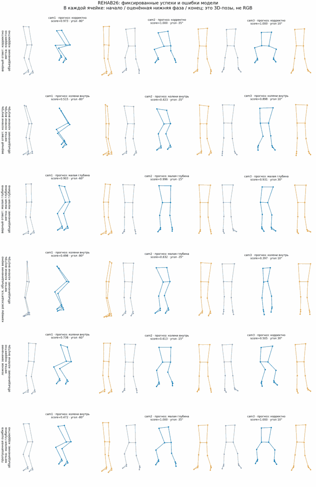

# Демонстрация REHAB26 на фиксированных примерах

Это иллюстрация уже полученных внешних предсказаний, а не новая оценка качества.
Шесть примеров заранее зафиксированы так, чтобы показать три верных класса,
расхождение камер, ложное замечание и пропущенную ошибку. Поэтому их нельзя
использовать для расчёта доли успешных случаев.

На рисунке показаны готовые MediaPipe world-позы в начале, оценённой нижней фазе
и конце повторения. Это не RGB-видео и не повторная экспертная разметка. Красные
кольца обозначают visibility ниже 0,5. `score` не является откалиброванной
вероятностью правильности.



| Случай | Человек | ID | Метка набора | cam1 / cam2 / cam3 | Среднее трёх камер |
|---|---|---|---|---|---|
| верный ответ: корректно | Vasil | `ex6_Vasil:10252-10294` | корректно | корректно / корректно / корректно | корректно (0.991) |
| верный ответ: колени внутрь | Mima | `ex6_Mima:11418-11481` | колени внутрь | колени внутрь / колени внутрь / колени внутрь | колени внутрь (0.612) |
| верный ответ: малая глубина | Petra | `ex6_Petra:10822-10898` | малая глубина | малая глубина / малая глубина / малая глубина | малая глубина (0.943) |
| камеры расходятся, объединение верно | Terka | `ex6_Terka:10107-10183` | колени внутрь | колени внутрь / малая глубина / колени внутрь | колени внутрь (0.377) |
| ложное замечание | Honza | `ex6_Honza:11895-12000` | корректно | колени внутрь / колени внутрь / корректно | колени внутрь (0.610) |
| пропущенная ошибка | Vasil | `ex6_Vasil:10074-10108` | малая глубина | колени внутрь / малая глубина / корректно | корректно (0.489) |

## Воспроизведение

Из корня репозитория после загрузки 3D-поз:

```bash
python scripts/download_rehab26.py --dimensions 3d
python scripts/build_rehab26_demo.py
```

Скрипт проверяет исходные метки, наличие трёх камер и сохранённые объединённые
ответы. Табличная версия примеров сохраняется в `examples.csv`.

## Как использовать в показе

1. Сначала показать три верных случая и объяснить три поддерживаемые категории.
2. Затем показать расхождение камер: одно движение получает разные ответы.
3. Закончить двумя ошибками системы. Это объясняет, почему результат пока нельзя
   использовать для автоматических рекомендаций и зачем нужна внешняя проверка.
